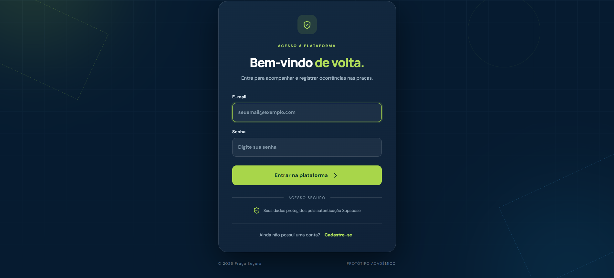
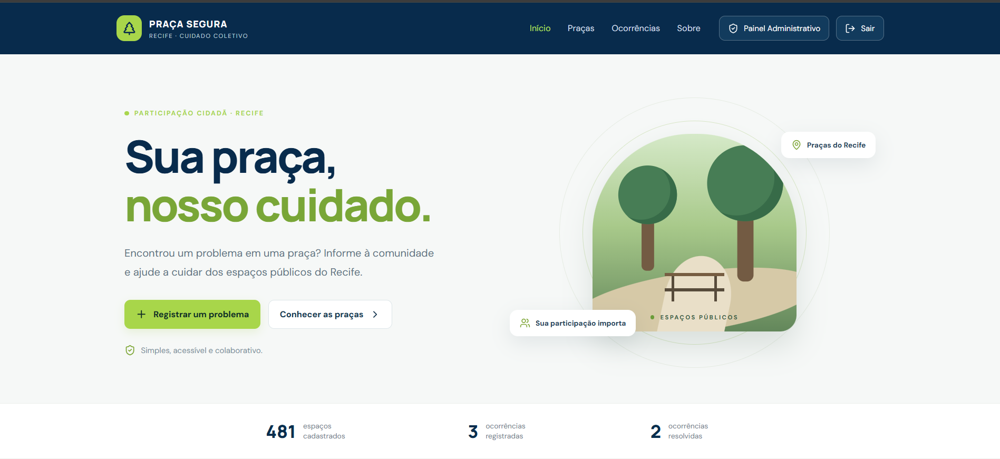
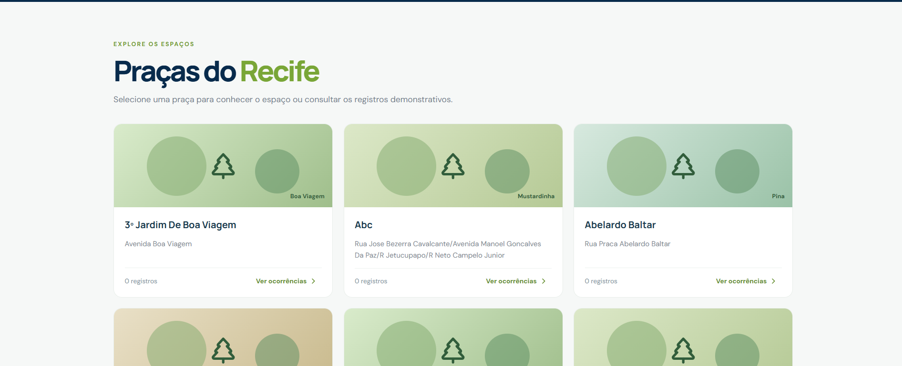

# 🌳 Praça Segura

### Tecnologia a serviço dos espaços públicos.

**Praça Segura** é uma aplicação web desenvolvida como protótipo acadêmico em 2026, com a proposta de incentivar a participação cidadã na conservação dos espaços públicos do Recife.

A plataforma permite registrar problemas encontrados em praças, anexar fotografias, informar a localização e acompanhar o andamento das ocorrências.

> Projeto acadêmico independente. Não representa um sistema oficial da Prefeitura do Recife.

---

## 📸 Demonstração da aplicação

### 1. Tela de login e cadastro



### 2. Tela inicial



### 3. Praças e ocorrências



---

## ✨ Funcionalidades

### Área do cidadão
- Cadastro e autenticação por e-mail e senha.
- Consulta de praças cadastradas.
- Registro de ocorrências.
- Seleção de categorias de problemas.
- Envio de fotografias.
- Captura de coordenadas por GPS.
- Geração e consulta de protocolos.
- Acompanhamento do status das ocorrências.
- Visualização dos próprios registros.

### Área administrativa
- Visualização das ocorrências cadastradas.
- Consulta de informações e fotografias.
- Atualização do status das solicitações.
- Acompanhamento dos registros enviados pelos cidadãos.

---

## 🛠️ Tecnologias utilizadas

| Tecnologia | Aplicação |
|---|---|
| React | Construção da interface |
| Vite | Ambiente de desenvolvimento |
| JavaScript | Lógica da aplicação |
| CSS | Estilização e responsividade |
| Supabase | Backend e serviços de dados |
| PostgreSQL | Banco de dados |
| Supabase Auth | Autenticação |
| Supabase Storage | Armazenamento de fotografias |
| Git e GitHub | Versionamento do código |

---

## 🏗️ Arquitetura e segurança

A aplicação utiliza o Supabase como infraestrutura de backend, com banco de dados PostgreSQL, autenticação e armazenamento de arquivos.

A segurança dos dados é apoiada por políticas de Row Level Security (RLS), que controlam o acesso às ocorrências conforme o usuário autenticado e seu perfil.

As fotografias são armazenadas em bucket privado, com acesso controlado por políticas e URLs temporárias assinadas.

---

## ⚙️ Como executar o projeto

### Pré-requisitos

- Node.js 18 ou superior.
- npm.
- Git.

### 1. Clonar o repositório

```bash
git clone https://github.com/MatheusCode27/praca-segura.git
```

### 2. Entrar na pasta

```bash
cd praca-segura
```

### 3. Instalar as dependências

```bash
npm install
```

### 4. Configurar as variáveis de ambiente

Crie um arquivo `.env` na raiz do projeto:

```env
VITE_SUPABASE_URL=sua_url_supabase
VITE_SUPABASE_ANON_KEY=sua_chave_publica_supabase
```

Utilize os dados do seu próprio projeto Supabase.

**Importante:** nunca publique arquivos `.env`, chaves `service_role` ou credenciais privadas.

### 5. Executar a aplicação

```bash
npm run dev
```

O Vite exibirá o endereço local para acessar a aplicação.

### 6. Gerar a versão de produção

```bash
npm run build
```

Para visualizar a versão compilada:

```bash
npm run preview
```

---

## 🗂️ Estrutura do projeto

```text
praca-segura/
│
├── screenshots/
│   ├── login.png
│   ├── inicio.png
│   └── ocorrencias.png
│
├── src/
│   ├── main.jsx
│   ├── style.css
│   └── supabase.js
│
├── .gitignore
├── index.html
├── package.json
├── package-lock.json
└── README.md
```

---

## 🛣️ Evolução do projeto

- [x] Desenvolvimento da interface web.
- [x] Implementação da autenticação.
- [x] Integração com Supabase.
- [x] Cadastro e consulta de ocorrências.
- [x] Perfis de cidadão e administrador.
- [x] Armazenamento privado de fotografias.
- [x] Controle de acesso com RLS.
- [x] Layout responsivo.
- [x] Publicação da aplicação na web.
- [ ] Ampliação e validação dos dados das praças.
- [ ] Avaliação de possíveis integrações institucionais.

---

## 🎓 Natureza acadêmica

O Praça Segura foi desenvolvido como projeto acadêmico em 2026, com finalidade educacional e demonstrativa.

As informações e os registros apresentados no sistema não devem ser considerados comunicações oficiais ou solicitações protocoladas junto à Prefeitura do Recife.

---

## 👨‍💻 Desenvolvimento

**Praça Segura — Recife**

Projeto acadêmico de desenvolvimento web.

**GitHub:** [MatheusCode27](https://github.com/MatheusCode27)

**Repositório:** [github.com/MatheusCode27/praca-segura](https://github.com/MatheusCode27/praca-segura)
